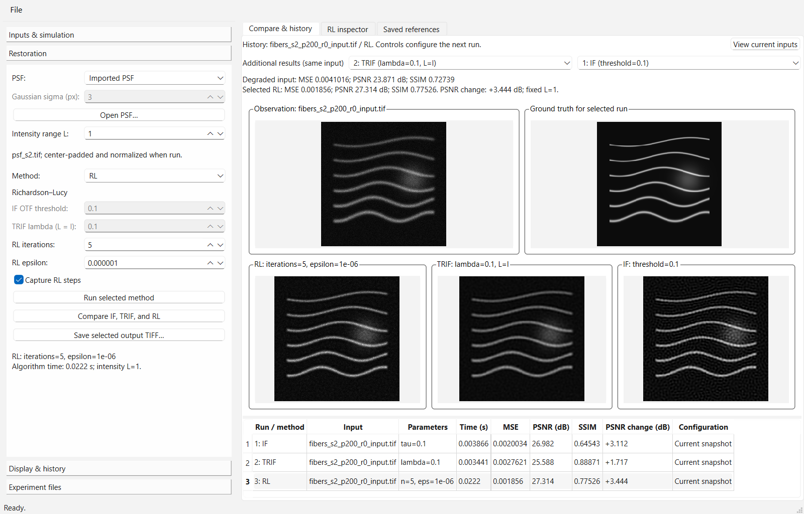

# Image Deconvolution

I built an offline Windows desktop app to investigate thresholded inverse
filtering (IF), zeroth-order Tikhonov (TRIF), and Richardson-Lucy (RL). The app
supports the group 07 image processing course project. I develop the desktop app
independently and retain [attribution](docs/attribution.md) for the group's reused
research code, synthetic images, and saved reference results.



## Run the Windows build

The updated local distribution is `dist/source-generation/Image Deconvolution/`;
the earlier evaluation folders are retained separately. Open
`ImageDeconvolution.exe` and keep its `_internal` folder alongside it. Python,
Fiji, a server, an account, and network access are not required to use the app.
This is an unsigned local evaluation build; no GitHub Release is published.
See the [user guide](docs/user-guide.md), [release notes](docs/release-notes.md),
and [third-party notices](docs/third-party-notices.md).

## Features and quick demonstration

1. Inputs & simulation > Saved example > Cells — reference, RL 5 > Load opens
   saved float TIFF input, ground truth, and the matching PSF. The Load button sits
   beside the selector; the sidebar stays on Inputs & simulation. Loading does
   not regenerate noise.
2. Restoration > Compare IF, TRIF, and RL runs all methods on identical input in
   a worker and displays all three outputs. Degraded-input and restored metrics
   share one ground truth/intensity scale; PSNR change makes improvements and
   regressions explicit. The table records input identity and algorithm time.
3. Select a history row with the mouse or arrow keys. Additional results selectors
   above the views list matching inputs only. View current inputs returns to the
   next run's workspace. Scroll to zoom and drag to pan the synchronized views.
4. RL inspector explains the five update phases and plots PSNR or SSIM at selected
   iterations when compatible ground truth exists. The saved bars example shows
   that late iterations can reduce quality.
5. Saved references computes six new Python comparisons against saved DL2 TIFFs.
   It separates agreement from restoration quality and labels saved ImageJ
   measurements. It never executes Fiji/ImageJ or a JAR.
6. Save numerical float TIFF or use Experiment files to export/reopen a versioned
   JSON bundle with exact input arrays, hashes, CSV measurements, and conventions.

The app also opens single grayscale TIFF/PNG files, generates or imports centered
normalized PSFs, and simulates seeded Poisson degradation explicitly.
Opening a clean source shows it only as ground truth; the observation stays empty
and restoration is disabled until Generate succeeds. Opening another source clears
the current observation/output preview while retaining run history. Integer
conversion and intensity range L are explicit. Without suitable ground truth,
quality measurements are unavailable with a reason. Parameter edits never
regenerate the observation or relabel a historical output.

## Develop from source

Use 64-bit Python 3.13 (verified with 3.13.6) on Windows. In PowerShell at the
repository root:

```powershell
py -3.13 -m venv .venv
.venv\Scripts\python.exe -m pip install -e .
.venv\Scripts\python.exe -B -m image_deconvolution
```

The alternative launcher is `.venv\Scripts\image-deconvolution.exe`. Exit through
File > Exit, Ctrl+Q, or the title bar; wait for a running worker to finish first.
Installation downloads dependencies; app processing is offline. Global packages
are not needed. Runtime versions are pinned in `pyproject.toml`: NumPy 2.3.3,
SciPy 1.16.2, Pillow 12.3.0, and PySide6 Essentials/Shiboken6 6.10.0. The build
backend is setuptools 82.0.1. Qt Charts is not used or bundled.

With `.venv` activated, apply automatic lint fixes and format code:

```powershell
ruff check --fix
ruff format
```

## Validate and build

```powershell
.venv\Scripts\python.exe -B -m unittest discover -s tests -v
.venv\Scripts\python.exe -m pip check
.venv\Scripts\python.exe -B -m image_deconvolution --verify-workflow "new verification folder"
.venv\Scripts\python.exe -m pip install -e ".[build]" -c packaging\build-constraints.txt
.venv\Scripts\python.exe -B tools\build_windows.py --dist-dir dist/source-generation
```

The maintained tests cover numerical invariants, image/PSF validation, fixed
observations, RL phases, saved references, exact experiment inputs, CSV/TIFF
round trips, worker failures and UI workflows. The verification command exercises
the real Qt window, actions, workers, inspector, references, export/reopen and
clean close. It writes a JSON result and three window captures into a new folder,
and denies Python socket connections during that run. The frozen executable
supports the same command:

```powershell
& ".\dist\source-generation\Image Deconvolution\ImageDeconvolution.exe" --verify-workflow "new packaged verification folder"
```

The builder refuses an existing distribution directory; --dist-dir selects a new
parent directory without replacing earlier builds. Build tools are pinned
in `packaging/build-constraints.txt`. The folder build keeps Qt DLLs dynamically
replaceable and includes third-party notices. Generated verification folders and
intermediate builds are disposable; the final local distribution is retained.

## Scientific scope and limitations

The numerical layer is independent of Qt. The baseline uses float64 computation,
2D grayscale known-PSF restoration, circular boundaries, thresholded IF, TRIF with
L=I, and RL initialized from the observation with epsilon 1e-6. PSNR uses an
explicit fixed intensity range (L=1 for normalized research data). Display
conversion does not affect metrics or exports. TIFF output rounds to float32.

The original 81 cases combine three synthetic images, three blur widths, three
photon levels, and three seeds; they are not 81 independent scenes. Saved inputs
are used for report comparisons. Same-seed regeneration across platforms need
not produce identical noise. The verified largest Python-to-saved-DL2 absolute
difference is 8.104919255735865e-7 for the recorded six comparisons, not a universal
tolerance. ImageJ MSE/PSNR are saved measurements; SSIM is calculated in Python.

The app supplements Fiji/ImageJ's reference role. It does not claim a new
algorithm or superiority over DeconvolutionLab2. Color/3D, blind deconvolution,
alternate boundaries, direct JAR execution and cancellation are outside this
version. Inputs are limited to 16 megapixels; history and RL capture are bounded.
The Windows build is verified on this machine, not a separate clean installation.
Research redistribution rights remain to be confirmed before public distribution;
no project-wide license is assigned to reused material.

See the [plan and verified progress](docs/plan.md) for implementation details.
